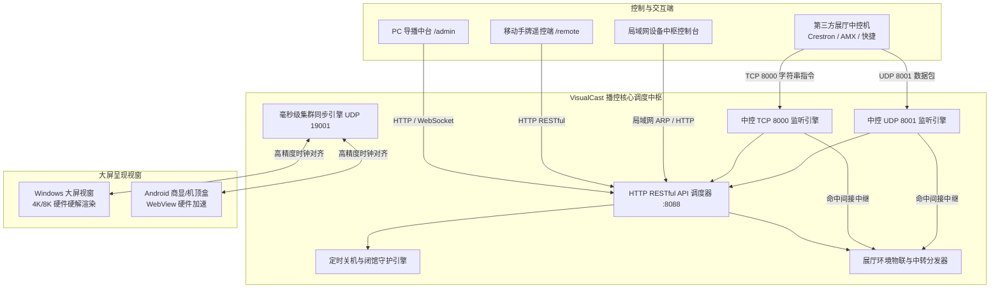

# VisualCast 工业级展馆可视化智能播控系统 · 软件规范与技术白皮书

> **系统名称**：VisualCast 工业级展馆可视化智能播控系统  
> **适用平台**：Windows 10/11 (x64) · Android 7.0~14 (TV/商显主板/工控盒)  
> **适用场景**：科技展厅、文博场馆、规划展览馆、企事业单位展陈、智慧文旅大屏、多联巨幕、沉浸式互动展项  
> **技术支持服务热线**：`19203642022`

---

## 目录
1. [系统概述与核心特性](#一系统概述与核心特性)
2. [总体系统架构与运行拓扑](#二总体系统架构与运行拓扑)
3. [多端运行环境与网络端口矩阵](#三多端运行环境与网络端口矩阵)
4. [核心功能清单全景说明](#四核心功能清单全景说明)
5. [外部智能中控通信协议与指令集 (TCP/UDP)](#五外部智能中控通信协议与指令集-tcpudp)
6. [展馆物联网自定义中转与协议分发网关 (IoT Forwarder Engine)](#六展馆物联网自定义中转与协议分发网关-iot-forwarder-engine)
7. [第三方系统集成 RESTful API 接口规范](#七第三方系统集成-restful-api-接口规范)
8. [多厂商开机自启动与防休眠常亮机制](#八多厂商开机自启动与防休眠常亮机制)
9. [U 盘即插即用素材热更新机制](#九u-盘即插即用素材热更新机制)
10. [运维与故障排查手册](#十运维与故障排查手册)

---

## 一、系统概述与核心特性

**VisualCast** 是一款专为现代多媒体展馆、数字展陈及商显大屏打造的工业级视听全能播控中枢。系统突破传统播放器解码能力单一、切换黑闪撕裂、外部集成繁琐等瓶颈，融合了 **超高清多媒体混合流水线**、**局域网毫秒级分布式集群联播**、**展馆环境 IoT 物联网中控联动与协议中转**、**底层硬件级防休眠常亮保活** 以及 **周排程精简定时关机** 等核心能力。

### 核心亮点
1. **广播级无缝切换**：采用双缓冲（Double Buffering）视频流水线，支持 4K/8K 硬件硬解加速，素材切换零黑闪、零卡顿；
2. **多终端全覆盖**：提供 Windows 桌面全屏大屏端、Android 电视/商显专用 APK、移动手持无线遥控手牌（`/remote`）及 PC 导播控制中台（`/admin`）；
3. **物联网多协议中转网关**：内置智能转发路由器，收到 UDP、TCP、HTTP、串口命令可跨网段、跨协议精准重组分发至继电器、灯控与下位机；
4. **展厅中控零门槛联动**：内嵌标准 TCP 8000 与 UDP 8001 监听中枢，全面兼容快思聪（Crestron）、AMX、华为、快捷等主流中控主机；
5. **极简精简定时关机**：专为展厅闭馆设计，仅保留精准的周排程定时关机，安全切断电源，杜绝误操作。

---

## 二、总体系统架构与运行拓扑

VisualCast 采用 **“极简硬件加速大屏呈现载体 + 强大网页全能中枢调度”** 的现代 B/S 与 C/S 混合分布式拓扑架构：



---

## 三、多端运行环境与网络端口矩阵

### 1. 访问网络地址矩阵

| 终端角色 | 访问地址 | 适用设备 | 主要职能与权限 |
| :--- | :--- | :--- | :--- |
| **PC 全功能管理中台** | `http://[本机IP]:8088/admin` | 播控机、导播台电脑 | 实时大屏镜像监视、素材分类库管理、中控调试、集群同步配置、中转规则编排、定时关机设置 |
| **大屏主呈现视窗** | `http://127.0.0.1:8088/player` | 现场主大屏、LED 拼接屏 | 全屏硬件加速放映、无缝切片、触控抽屉快捷运维 |
| **讲解员手持遥控端** | `http://[本机IP]:8088/remote` | 手机、iPad、手持平板 | 极简讲解遥控，物理级屏蔽危险关机与删除设置，支持切曲、音量、翻页 |

### 2. 系统监听网络端口

| 协议 | 端口 | 功能说明 | 防火墙策略 |
| :--- | :--- | :--- | :--- |
| **TCP** | `8088` | 核心 HTTP 调度服务、静态网页呈现、RESTful API 通信 | 允许局域网入站 |
| **TCP** | `8000` | 展馆第三方网络中控长连接指令监听中枢 | 允许局域网入站 |
| **UDP** | `8001` | 展馆第三方网络中控无连接快速数据包监听 | 允许局域网入站 |
| **UDP** | `19001` | 分布式集群多机联播毫秒级高精度时钟同步与心跳 | 允许局域网组播/广播 |
| **TCP** | `5900` | 展厅内嵌工业级 VNC 远程镜像监视与反向触控端口 | 允许局域网入站 |

---

## 四、核心功能清单全景说明

### 1. 全媒体格式无缝播放
* **视频流**：MP4, MOV, MKV, WebM, AVI, FLV (支持 H.264/H.265/AV1 4K/8K 硬件加速)；
* **静态图库**：PNG, JPG, JPEG, WebP, BMP, GIF (全屏自适应，智能居中缩放)；
* **高保真音频**：MP3, WAV, AAC, FLAC, OGG (内嵌实时声学水波纹光盘可视化效果)；
* **演示文稿与讲稿**：
  * **PPT / PPTX**：原生对接 WPS / PowerPoint 进程，前台置顶放映并提供触控翻页悬浮条；
  * **PDF 矢量文档**：内置矢量切片渲染引擎，支持单页全屏与现场上一页/下一页翻动；
* **HTML5 交互展项与流媒体**：
  * 支持三维 WebGL、数据可视化大屏嵌入；
  * 搭载 `closeActiveWebFrame` 强力注销机制，切换素材瞬间销毁页面，彻底杜绝声音残留与显存泄漏；
  * 原生解析 M3U8 (HLS)、RTSP、RTMP、HTTP-FLV 网络直播监控流。

### 2. 经典 6 大素材分类与播控胶囊
* 素材库分类：**【全部】**、**【🏠 待机轮播】**、**【🎬 视频】**、**【🖼️ 图片】**、**【📑 文档】**、**【🎵 音乐】**、**【🌐 网页/流】**；
* 快捷播控条：一键**【🏠 回待机】**、一键**【🔁 循环模式切换】**（支持文件夹循环 / 单曲循环 / 全部循环 / 单次播放）；
* 正在播出外发光：当前播放素材在列表中自动高亮加边框并平滑居中对齐滚动。

### 3. 受控端大屏快捷抽屉面板 (按 H 键或右下角5击唤出)
* **受控端通信网卡自适应切换**；
* **运维全屏与窗口化切换**（支持 1280×720 便捷调试）；
* **屏幕方向旋转**（横屏 16:9 / 竖屏 9:16 一键切换）；
* **精简定时关机排程**（仅保留定时关机时间与星期排程自由勾选，杜绝硬件无法开机的虚假功能）；
* **外部第三方应用程序管理**（支持注册自定义 EXE/App 路径，**带顺畅科技感纵向滚动滑动条**，现场一键拉起沙盘、游戏等）。

---

## 五、外部智能中控通信协议与指令集 (TCP/UDP)

系统内置高性能中控监听服务，支持 **TCP 端口 8000**（支持长连接保持与应答）以及 **UDP 端口 8001**（即发即收）。指令支持纯文本字符串格式，每条指令以换行符 `\n` 或 `\r\n` 结尾。

### 1. 播控状态调度指令

| 中控指令文本 | 作用描述 | 示例与参数说明 |
| :--- | :--- | :--- |
| `PLAY` | 恢复播放当前媒体（解除暂停） | `PLAY\n` |
| `PAUSE` | 暂停播放当前媒体 | `PAUSE\n` |
| `STOP` 或 `STANDBY` | 停止当前播放并立即返回默认待机底片/轮播 | `STANDBY\n` |
| `NEXT` | 播放下一个素材 / 文档翻下一页 | `NEXT\n` |
| `PREV` | 播放上一个素材 / 文档翻上一页 | `PREV\n` |
| `SWITCH:<文件名>` | 强制点播指定素材（支持分类子路径） | `SWITCH:企业宣传片.mp4\n`<br>`SWITCH:视频/展厅介绍.mp4\n` |
| `SWITCH_INDEX:<序号>`| 按当前素材列表序号点播（从 0 开始） | `SWITCH_INDEX:2\n` |
| `LOOP_MODE:<模式>` | 设定播放模式：`FOLDER_LOOP` / `SINGLE_LOOP` / `ALL_LOOP` / `PLAY_ONCE` | `LOOP_MODE:FOLDER_LOOP\n` |

### 2. 视听效果与硬件黑场控制指令

| 中控指令文本 | 作用描述 | 示例与参数说明 |
| :--- | :--- | :--- |
| `VOL:<0~100>` | 绝对调节系统主音量百分比 | `VOL:80\n` |
| `VOL_UP` / `VOL_DOWN` | 系统音量步进递增 / 递减 5% | `VOL_UP\n` |
| `MUTE` / `UNMUTE` | 系统全局静音 / 解除静音 | `MUTE\n` |
| `BLACKOUT:ON` | 紧急黑场屏蔽（瞬间遮盖黑屏，保持播放后台静音） | `BLACKOUT:ON\n` |
| `BLACKOUT:OFF` | 解除黑场屏蔽，瞬时恢复大屏画面呈现 | `BLACKOUT:OFF\n` |
| `FREEZE:ON` | 静帧定格（画面瞬时定格，音视频暂停） | `FREEZE:ON\n` |
| `FREEZE:OFF` | 解除静帧定格，继续播放 | `FREEZE:OFF\n` |

### 3. 主机系统运维指令

| 中控指令文本 | 作用描述 | 示例与参数说明 |
| :--- | :--- | :--- |
| `SHUTDOWN` | 执行大屏关机（**安卓版**为黑场加停止播放；**EXE版**为底层系统安全关机） | `SHUTDOWN\n` |
| `POWERON` / `WAKEUP` | 执行大屏开机（关闭黑场，恢复待机文件放映） | `POWERON\n` |
| `REBOOT` | 立即执行大屏系统重启或播控视窗重载 | `REBOOT\n` |
| `LAUNCH_APP:<应用名>` | 一键拉起已注册的外部第三方应用程序 | `LAUNCH_APP:3D数字沙盘\n` |
| `STATUS` | 查询播控引擎当前运行状态（返回 JSON） | `STATUS\n` |

---

## 六、展馆物联网自定义中转与协议分发网关 (IoT Forwarder Engine)

### 1. 核心架构与中继原理

VisualCast 创新内置**工业级多协议物联网中转路由器**。当现场展馆收到来自第三方中控、串口传感器、红外雷达或网络控制端发来的指定指令时，可自动按配置的多条自定义规则，跨协议、跨 IP、跨端口中继分发至目标设备，充当展厅微型中控中枢与协议桥接网关。

```
[外部指令源]
   │
   ├──▶ 1. UDP 8001 (中控单播 / 局域网广播) ─────┐
   ├──▶ 2. TCP 8000 (中控长短连接通讯) ─────────┤
   ├──▶ 3. SERIAL (COM 串口持续监听接收) ───────┼──▶ 【IoT 智能中转路由器】
   └──▶ 4. HTTP POST (/api/iot/trigger API) ────┘         │
                                                           │ (匹配规则: 包含/全等/前缀/HEX)
                                                           ▼
                                            ┌─────────────────────────────┐
                                            │     自定义协议重组与分发     │
                                            │ (支持 {{RAW}} 原始数据透传) │
                                            └──────────────┬──────────────┘
                                                           │
          ┌────────────────┬───────────────────────────────┼──────────────────────────────┐
          ▼                ▼                               ▼                              ▼
    【TCP Client】    【UDP 单播/广播】             【HTTP REST/WebHook】          【SERIAL 串口设备】
    发送 Hex/文本     发送广播/Art-Net             请求外部 API 接口               向物理串口写出
    (继电器/灯控)     (DMX512/投影机)              (空调/新风/云平台)             (雷达/机械臂/PLC)
```

### 2. 匹配规则与过滤机制

每条中转规则由**【输入监听源】**与**【输出目标端】**两部分组成：

1. **输入协议匹配 (`match_protocol`)**：
   * `ALL`：不限输入源，所有通过 TCP 8000、UDP 8001、HTTP 接口或串口收到的命令均进行比对；
   * `UDP`：仅监听 UDP 8001 端口进来的数据包；
   * `TCP`：仅监听 TCP 8000 端口进来的长短连数据包；
   * `SERIAL`：启动后台守护监听指定物理串口（如 `COM1` @ 9600bps），收到下位机/雷达传感器回传字符时触发；
   * `HTTP`：仅监听第三方 HTTP 接口推送。
2. **命令匹配类型 (`match_type`)**：
   * `CONTAINS`：包含匹配（只要接收到的文本包含关键字即可触发，如包含 `RELAY_POWER_ON`）；
   * `EXACT`：全字精确匹配（区分大小写或严格相等）；
   * `STARTSWITH`：前缀匹配（如指令以 `DMX_SCENE:` 开头）；
   * `HEX`：十六进制模糊匹配（比对 Hex 字节流，支持空格与大小写自动清洗，如 `01 05 00 01`）。
3. **数据透传与动态占位符 (`{{RAW}}`)**：
   * 若转发目标命令内容配置为包含 `{{RAW}}`，系统将自动将收到的原始字符串动态插值注入。例如：收到 `VOLUME:85`，转发命令配置为 `#SET_VOL {{RAW}}\r\n`，最终发出的数据为 `#SET_VOL VOLUME:85\r\n`。若目标命令留空，则默认纯 RAW 透传。
4. **时序避让延时 (`delay_ms`)**：
   * 支持 0~60000 毫秒延时。对于展厅时序电源或多路设备并发冲突场景，可精准设置执行延时（如延迟 500ms），实现多设备有序分步触发。

### 3. 支持的转发目标协议全景

| 目标协议 | 目标地址配置 | 目标端口/参数 | 数据格式支持 | 典型展馆应用场景 |
| :--- | :--- | :--- | :--- | :--- |
| **TCP** | 目标主机 IP | 通信端口 (如 4001) | TEXT / HEX / RAW | 智能继电器模块、时序电源、矩阵切换器、PJLink 激光投影机 |
| **UDP** | 目标 IP / 广播 IP (如 `192.168.1.255`) | UDP 端口 (如 8000) | TEXT / HEX / RAW | Art-Net 舞台灯光控制器、DMX512 氛围灯、快思聪中控集群 |
| **HTTP** | 目标主机 IP 或完整 URL | HTTP 端口 (默认 80) | TEXT (URL / API) | 智能温控新风空调网关、第三方云平台 WebHook、REST 控制器 |
| **SERIAL** | 目标串口号 (如 `COM2`) | 波特率 (如 9600) | TEXT / HEX / RAW | RS232/RS485 总线、步进电机控制器、机械升降幕帘、PLC |
| **WOL** | 目标网卡 MAC (如 `00:11:22:33:44:55`) | 广播端口 (默认 9) | 魔术唤醒包 (Magic Packet)| 唤醒关机的展厅从机工作站、交互触摸台、渲染服务器 |

---

## 七、第三方系统集成 RESTful API 接口规范

VisualCast 提供基于 HTTP JSON 协议的开放式 RESTful API，默认端口为 `8088`。

### 1. 播放调度接口

#### 1.1 触发播控动作
* **URL**: `/api/player/command`
* **Method**: `POST`
* **Content-Type**: `application/json`
* **请求体示例**:
```json
{
  "command": "LOAD_AND_PLAY",
  "params": {
    "media": "视频/宣传片.mp4",
    "loop_mode": "PLAY_ONCE"
  }
}
```
* **可选指令 (`command`)**:
  * `PLAY` / `PAUSE` / `STOP` / `NEXT` / `PREV`
  * `BLACKOUT` (`{"enabled": true/false}`)
  * `FREEZE` (`{"enabled": true/false}`)
  * `SET_VOLUME` (`{"volume": 85}`)
  * `SET_MUTED` (`{"muted": true}`)

#### 1.2 获取实时状态快照
* **URL**: `/api/player/status`
* **Method**: `GET`
* **返回示例**:
```json
{
  "status": "ok",
  "data": {
    "current_media": "视频/宣传片.mp4",
    "state": "PLAYING",
    "position": 45.2,
    "duration": 180.0,
    "volume": 85,
    "muted": false,
    "blackout": false,
    "fullscreen": true,
    "idle_media": "default_standby.jpg"
  }
}
```

---

### 2. 物联网自定义中转与协议分发接口

#### 2.1 查询所有中转规则与统计
* **URL**: `/api/iot/forwarders`
* **Method**: `GET`
* **返回示例**:
```json
{
  "status": "ok",
  "forwarders": [
    {
      "id": "fwd_relay_01",
      "name": "UDP中控指令中转继电器",
      "enabled": true,
      "match_protocol": "UDP",
      "match_type": "CONTAINS",
      "match_cmd": "RELAY_POWER_ON",
      "target_protocol": "TCP",
      "target_host": "192.168.1.188",
      "target_port": 4001,
      "target_data_format": "HEX",
      "target_cmd": "01 05 00 01 FF 00",
      "delay_ms": 0,
      "trigger_count": 12,
      "last_triggered_time": "2026-10-11 16:30:00"
    }
  ]
}
```

#### 2.2 保存或更新中转规则
* **URL**: `/api/iot/forwarders`
* **Method**: `POST`
* **请求体**: 规则 JSON 对象。

#### 2.3 快速切换规则启停
* **URL**: `/api/iot/forwarders/toggle`
* **Method**: `POST`
* **请求体**:
```json
{
  "id": "fwd_relay_01",
  "enabled": false
}
```

#### 2.4 手动单步模拟测试中转
* **URL**: `/api/iot/forwarders/test`
* **Method**: `POST`
* **请求体**:
```json
{
  "id": "fwd_relay_01"
}
```

#### 2.5 外部 HTTP 触发指令分发与中转
* **URL**: `/api/iot/trigger`
* **Method**: `POST`
* **说明**: 外部第三方系统可通过此 HTTP 接口模拟推送指令，系统将同时触发本机播控/开闭馆宏与满足条件的中转转发。
* **请求体**:
```json
{
  "cmd": "SWITCH:1",
  "protocol": "HTTP"
}
```

#### 2.6 多媒体与物联设备同步时间轴接口 (Timeline Sync)
* **获取时间轴配置**: `GET /api/iot/timeline`
* **保存时间轴编排**: `POST /api/iot/timeline`
* **请求/返回数据结构**:
```json
{
  "status": "ok",
  "timeline": {
    "master": {
      "type": "video",
      "name": "开场宣传片.mp4",
      "url": "/media/video/开场宣传片.mp4",
      "duration": 60
    },
    "tracks": [
      {
        "id": "track_light",
        "name": "展厅顶光与氛围照明轨",
        "nodes": [
          {
            "id": "node_1",
            "time": 5.0,
            "device_id": "ambient_light_01",
            "action": "on",
            "custom_cmd": "",
            "label": "顶光开启"
          }
        ]
      }
    ]
  }
}
```
* **功能特性**:
  1. **媒体主轴**: 自由载入图片、音乐、视频，支持自定义播放总时长；
  2. **多条同步副轴**: 下方可创建多条独立受控设备时间轴，支持在任意时间戳添加、拖拽、编辑上方已配置设备的开机(ON)、关机(OFF)或自定义指令；
  3. **走带精准触发**: 支持预览播放、循环、大屏投送同步；游标到达关键帧秒数时自动调用物联通信驱动向物理硬件发送指令。

---

### 3. 素材管理接口

#### 3.1 获取全媒体素材列表
* **URL**: `/api/media`
* **Method**: `GET`
* **返回示例**:
```json
{
  "status": "ok",
  "files": [
    {
      "name": "待机/背景轮播.mp4",
      "filename": "背景轮播.mp4",
      "folder": "待机",
      "type": "video",
      "size": 45283920,
      "mtime": 1770000000,
      "url": "/media/待机/背景轮播.mp4"
    }
  ]
}
```

#### 3.2 上传素材文件
* **URL**: `/api/media/upload`
* **Method**: `POST`
* **Content-Type**: `multipart/form-data`
* **参数**:
  * `file`: 二进制文件数据
  * `folder`: 目标分类子目录（如 `视频`、`图片`、`待机` 等）

#### 3.3 素材复制与剪切/移动接口 (待机与其他文件夹相互复制粘贴)
* **URL**: `/api/media/transfer`
* **Method**: `POST`
* **作用**: 实现素材在【待机轮播】与【视频】、【图片】、【文档】、【音乐】、【网页/流】等标准分类之间的相互复制与剪切移动。同一目录下复制自动生成 `_副本`，跨目录移动自动迁移对应配置。
* **POST 请求体**:
```json
{
  "action": "copy", // "copy" 为复制，"move" 为剪切移动
  "sources": ["视频/宣传片.mp4"],
  "target_folder": "待机" // 目标文件夹名称（如 "待机"、"视频"、"图片" 等）
}
```
* **返回数据**:
```json
{
  "status": "ok",
  "action": "copy",
  "target_folder": "待机",
  "success_count": 1,
  "message": "成功复制 1 个素材至【待机】",
  "results": [
    { "name": "视频/宣传片.mp4", "new_name": "待机/宣传片.mp4", "status": "ok" }
  ]
}
```

---

### 4. 系统运维与定时排程接口

#### 4.1 获取或保存定时关机排程
* **URL**: `/api/system/scheduled_shutdown`
* **Method**: `GET` / `POST`
* **平台行为特性**:
  * **Windows (EXE) 版**：**只有执行关机定时**。到达设定时间后，后台高精度守护进程自动执行 Windows 底层安全关机切断电源 (`shutdown /s /f /t 0`)；
  * **Android (APK) 版**：到达定时关机时间后，自动执行**黑场加停止播放**；反之，若到达开机时间或收到唤醒指令，自动**关闭黑场，播放待机文件**，确保商用平板或车载设备后台服务不中断。
* **POST 请求体**:
```json
{
  "enabled": true,
  "boot_enabled": true,
  "boot_time": "08:30",
  "shutdown_time": "21:30",
  "weekdays": [1, 2, 3, 4, 5, 6, 7]
}
```
* **参数说明**:
  * `enabled`: 启用每日定时关机排程（Windows EXE 切断电源关机 / Android 黑场停播）；
  * `boot_enabled`: 【安卓端专属】启用每日定时开启开关；
  * `boot_time`: 【安卓端专属】每日定时开启时间（HH:MM，到达时间自动关闭黑场，恢复待机文件放映）；
  * `shutdown_time`: 每日定时关机时间（HH:MM）；
  * `weekdays`: 星期几自定义组合生效数组（`[1,2,3,4,5,6,7]` 分别代表周一至周日）。

#### 4.2 紧急中止今日关机
* **URL**: `/api/system/cancel_shutdown`
* **Method**: `POST`
* **作用**: 通宵运维或临时接待时一键跳过今日关机排程。

#### 4.3 远程开机与唤醒接口
* **URL**: `/api/system/power_on` 或 `/api/system/wakeup`
* **Method**: `POST`
* **作用**: 远程开机唤醒大屏，关闭黑场并恢复待机文件轮播。

#### 4.4 屏幕与视窗切换接口 (多物理显示器与横竖屏方向)
* **物理显示器枚举与跨屏切换**:
  * **URL**: `/api/system/monitors`
  * **Method**: `GET`（获取主机连接的所有物理显示器列表及大屏所在屏幕） / `POST`（将大屏窗口投射到指定屏幕）
  * **POST 请求体**: `{"index": 1}`（将大屏呈现窗口瞬间跨屏移动并全屏投映至屏幕 #2，支持多屏扩展环境）
* **大屏横竖屏方向切换**:
  * **URL**: `/api/player/command`
  * **Method**: `POST`
  * **请求体**: `{"command": "SET_ORIENTATION", "params": {"orientation": "portrait"}}`（或 `"landscape"`）
  * **平台特性**: Windows 端通过播放视窗旋转矩阵毫秒级翻转画面；Android 端联动底层 `Activity.setRequestedOrientation` 改变屏幕方向。

---

## 八、多厂商开机自启动与防休眠常亮机制

### 1. Windows 端
* **注册表 Run 键自启动**：在 `HKCU\Software\Microsoft\Windows\CurrentVersion\Run` 写入自启动路径；
* **Win32 物理防休眠**：软件运行期间调用 `SetThreadExecutionState(ES_CONTINUOUS | ES_SYSTEM_REQUIRED | ES_DISPLAY_REQUIRED)`，确保 Windows 绝对不黑屏不熄屏。

### 2. Android 端 (商显板卡全场景组合拳)
* **广播矩阵覆盖**：全面监听 `BOOT_COMPLETED`、`LOCKED_BOOT_COMPLETED`、`QUICKBOOT_POWERON`、`REBOOT`、视美泰主板广播 `com.smdt.action.BOOT_COMPLETED`、外接电源通电 `ACTION_POWER_CONNECTED` 及应用覆盖更新 `MY_PACKAGE_REPLACED`；
* **阶梯防抖与加固拉起**：内置 6 秒防抖锁，开机获取 10 秒 WakeLock，并延迟 1.5s 与 3.5s 阶梯式重试拉起，防止被系统桌面压制后台；
* **电池白名单自动申请**：运行即自动引导加入系统忽略电池优化白名单，防止后台休眠杀死。

---

## 九、U 盘即插即用素材热更新机制

展厅现场运维人员只需将普通 U 盘插上播控主机，即可实现自动增量覆盖更新：
1. 在 U 盘根目录建立 `素材`、`素材文件夹` 或 `media` 文件夹（或在根目录下直接放置分类文件夹）；
2. 按照 6 大标准分类建立子目录放置文件：
   * `素材/待机/`：待机底片或轮播素材（**更新策略**：以 U 盘为主，检测到待机素材后自动**先清空删除本地原有待机文件**，再全新拷贝导入覆盖更新）；
   * `素材/视频/`：超清宣传视频；
   * `素材/图片/`：静态展陈图库；
   * `素材/文档/`：PPT 文稿与 PDF 讲稿；
   * `素材/音乐/`：展厅背景音乐；
   * `素材/网页_流码/`：H5 压缩包与直播流配置；
3. U 盘插入后大屏浮现气泡提示，若未检测到素材文件夹则保护跳过，拔出 U 盘大屏即时生效播放；
4. **参数直接固化机制**：所有在大屏端或管理后台完成的配置调整（横竖屏旋转、画面比例、循环模式、切片时长、左右触摸按键、定时开关机排程、开机自启等），设置完成后立即持久化存盘，下次开机启动时 100% 按照固化参数自动运行。

---

## 十、运维与故障排查手册

| 常见现象 | 可能原因 | 解决处置方案 |
| :--- | :--- | :--- |
| **外部中控发送指令大屏无反应** | 端口被防火墙拦截或指令缺失换行符 | 1. 确保中控主机连入同局域网；<br>2. 开放 Windows 防火墙 TCP 8000 与 UDP 8001 端口；<br>3. 中控指令末尾务必携带 `\n`。 |
| **自定义中转规则未执行** | 规则未启用、协议不匹配或目标端口未开 | 1. 在后台【自定义中转】卡片中点击【测试】排查网络连通性；<br>2. 检查接收协议是否设置为 ALL 或对应的 UDP/TCP/串口；<br>3. 检查串口号 COM 是否存在且未被其他软件独占。 |
| **视频播放黑屏但有声音** | 显卡缺少硬件解码器或编码格式异常 | 优先推荐使用标准 H.264 / AAC 编码的 MP4 视频，确保显卡驱动已正常安装。 |
| **受控端抽屉菜单如何唤出** | 展厅防误触设计 | 1. 物理键盘按下 **H** 键；<br>2. 触控大屏在右上角快速连续点击 5 次即可唤出抽屉。 |
| **Android 盒子上电后未自启** | 系统限制了后台启动或电池优化 | 1. 在设置中将 VisualCast 设为默认桌面应用（Home Launcher）；<br>2. 开启自启动权限并允许忽略电池优化。 |
