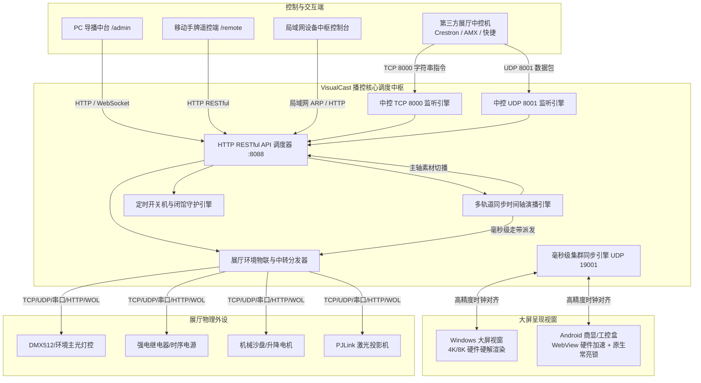
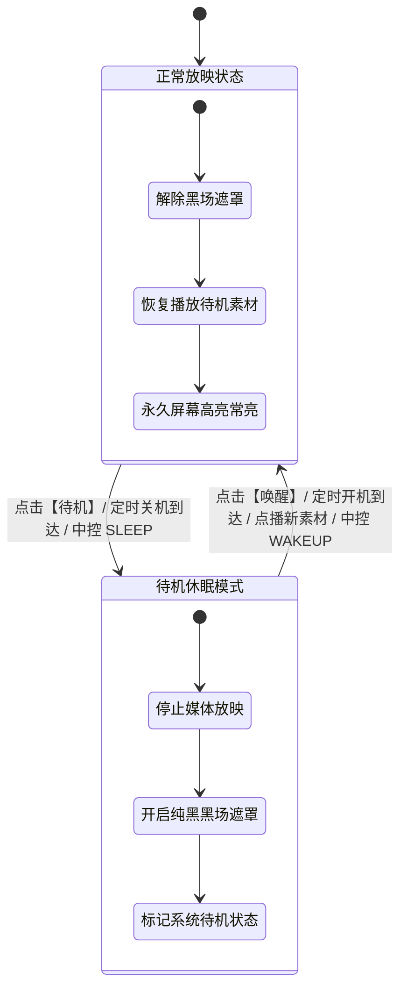

# VisualCast 工业级展馆可视化智能播控系统 · 软件规范与技术白皮书

> **系统名称**：VisualCast 工业级展馆可视化智能播控系统  
> **适用平台**：Windows 10/11 (x64) · Android 7.0~14 (TV/商显主板/工控盒)  
> **适用场景**：科技展厅、文博场馆、规划展览馆、企事业单位展陈、智慧文旅大屏、多联巨幕、沉浸式互动展项  
> **技术支持服务热线**：`19203642022`

---

## 目录
1. [系统概述与核心特性](#一系统概述与核心特性)
2. [总体系统架构与运行拓扑](#二总体系统架构与运行拓扑)
3. [多端运行环境与网络端口矩阵](#三多端运行环境与网络端口矩阵)
4. [核心功能清单全景说明](#四核心功能清单全景说明)
5. [展馆多媒体与物联设备同步时间轴工作室 (Timeline Studio)](#五展馆多媒体与物联设备同步时间轴工作室-timeline-studio)
6. [大屏待机与唤醒、黑场互锁工作机制](#六大屏待机与唤醒黑场互锁工作机制)
7. [外部智能中控通信协议与指令集 (TCP/UDP)](#七外部智能中控通信协议与指令集-tcpudp)
8. [展馆物联网自定义中转与协议分发网关 (IoT Forwarder Engine)](#八展馆物联网自定义中转与协议分发网关-iot-forwarder-engine)
9. [第三方系统集成 RESTful API 接口规范](#九第三方系统集成-restful-api-接口规范)
10. [底层硬件级防休眠常亮保活与开机自启动机制](#十底层硬件级防休眠常亮保活与开机自启动机制)
11. [U 盘即插即用素材热更新机制](#十一u-盘即插即用素材热更新机制)
12. [运维与故障排查手册](#十二运维与故障排查手册)

---

## 一、系统概述与核心特性

**VisualCast** 是一款专为现代多媒体展馆、数字展陈及商显大屏打造的工业级视听全能播控中枢。系统突破传统播放器解码能力单一、切换黑闪撕裂、外部硬件联动繁琐等瓶颈，融合了 **超高清多媒体混合流水线**、**声光电视讯机电一体化时间轴工作室**、**局域网毫秒级分布式集群联播**、**待机/唤醒状态互锁黑场遮罩**、**底层硬件级防休眠永久高亮常亮保活** 以及 **多协议物联网中继分发网关** 等核心能力。

### 核心亮点
1. **广播级无缝切换**：采用双缓冲（Double Buffering）视频流水线，支持 4K/8K 硬件加速，素材切换零黑闪、零卡顿；
2. **多轨道物联时间轴工作室**：具备专业非编级多轨道编排能力，主媒体轴与多条设备控制副轨在走带时微秒级对齐，大屏播放到指定画面即时触发灯光、沙盘模型或继电器动作；
3. **高可靠待机与唤醒机制**：
   - **待机模式**：执行停止媒体放映 + 启用全屏纯黑黑场遮罩；
   - **唤醒模式**：解除黑场遮罩 + 自动从待机目录恢复播放待机素材（视频/图片）；
   - 后台管理端、移动手牌遥控端与中控协议全链路按键互锁、状态实时双向同步；
4. **底层硬件级防休眠永久常亮**：
   - Android 端采用无超时限制的持久 `SCREEN_BRIGHT_WAKE_LOCK`，结合 `FLAG_KEEP_SCREEN_ON`、`setTurnScreenOn(true)`、`setShowWhenLocked(true)` 与 `requestDismissKeyguard`，彻底杜绝定时开机或唤醒后因屏幕休眠超时“刚亮屏又熄灭”的顽疾；
5. **多终端控制矩阵**：提供 Windows 桌面全屏大屏端、Android 电视/商显专用 APK、移动手持无线遥控手牌（`/remote`）及 PC 导播中台（`/admin`）；
6. **展厅中控零门槛联动**：内嵌标准 TCP 8000 与 UDP 8001 监听中枢，全面兼容快思聪（Crestron）、AMX、华为、快捷等主流中控主机；
7. **周排程精简定时开关机/待机**：专为展厅闭馆/开馆设计，支持自定义星期组合与 HH:mm 定时核验，自动化休眠待机与亮屏开馆。

---

## 二、总体系统架构与运行拓扑

VisualCast 采用 **“极简硬件加速大屏呈现载体 + 强大网页全能中枢调度 + 物理外设底层通讯驱动”** 的现代混合分布式拓扑架构：



---

## 三、多端运行环境与网络端口矩阵

### 1. 访问网络地址矩阵

| 终端角色 | 访问地址 | 适用设备 | 主要职能与权限 |
| :--- | :--- | :--- | :--- |
| **PC 全功能管理中台** | `http://[本机IP]:8088/admin` | 播控机、导播台电脑 | 实时大屏镜像监视、素材分类库管理、时间轴工作室、中控调试、物联中转配置、定时排程设置 |
| **大屏主呈现视窗** | `http://127.0.0.1:8088/player` | 现场主大屏、LED 拼接屏 | 全屏硬件加速放映、无缝切片、触控抽屉快捷运维 |
| **讲解员手持遥控端** | `http://[本机IP]:8088/remote` | 手机、iPad、手持平板 | 极简讲解遥控，支持播放/暂停、停止(切待机图片)、切曲、黑场遮罩、待机/唤醒互锁、音量调节 |

### 2. 系统监听网络端口

| 协议 | 端口 | 功能说明 | 防火墙策略 |
| :--- | :--- | :--- | :--- |
| **TCP** | `8088` | 核心 HTTP 调度服务、静态网页呈现、RESTful API 通信 | 允许局域网入站 |
| **TCP** | `8000` | 展馆第三方网络中控长连接指令监听中枢 | 允许局域网入站 |
| **UDP** | `8001` | 展馆第三方网络中控无连接快速数据包监听 | 允许局域网入站 |
| **UDP** | `19001` | 分布式集群多机联播毫秒级高精度时钟同步与心跳 | 允许局域网组播/广播 |
| **TCP** | `5900` | 展厅内嵌工业级 VNC 远程镜像监视与反向触控端口 | 允许局域网入站 |

---

## 四、核心功能清单全景说明

### 1. 全媒体格式无缝播放
* **视频流**：MP4, MOV, MKV, WebM, AVI, FLV (支持 H.264/H.265/AV1 4K/8K 硬件硬解加速)；
* **静态图库**：PNG, JPG, JPEG, WebP, BMP, GIF (全屏自适应，智能居中缩放)；
* **高保真音频**：MP3, WAV, AAC, FLAC, OGG (内嵌实时声学水波纹光盘可视化效果)；
* **演示文稿与讲稿**：
  * **PPT / PPTX**：原生对接 WPS / PowerPoint 进程，前台置顶放映并提供触控翻页悬浮条；
  * **PDF 矢量文档**：内置矢量切片渲染引擎，支持单页全屏与现场上一页/下一页翻动；
* **HTML5 交互展项与流媒体**：
  * 支持三维 WebGL、数据可视化大屏嵌入；
  * 搭载 `closeActiveWebFrame` 强力注销机制，切换素材瞬间销毁页面，彻底杜绝声音残留与显存泄漏；
  * 原生解析 M3U8 (HLS)、RTSP、RTMP、HTTP-FLV 网络直播监控流。

### 2. 标准 6 大素材分类体系
* 素材库分类：**【全部】**、**【🏠 待机】**、**【🎬 视频】**、**【🖼️ 图片】**、**【📑 文档】**、**【🎵 音乐】**、**【🌐 网页/流】**；
* 快捷播控条：一键**【🏠 回待机】**、一键**【🔁 循环模式切换】**（支持文件夹循环 / 单曲循环 / 全部循环 / 单次播放）；
* 正在播出外发光：当前播放素材在列表中自动高亮加边框并平滑居中对齐滚动。

### 3. 受控端大屏快捷抽屉面板 (按 H 键或右下角5击唤出)
* **受控端通信网卡自适应切换**；
* **运维全屏与窗口化切换**（支持 1280×720 便捷调试）；
* **屏幕方向旋转**（横屏 16:9 / 竖屏 9:16 一键切换）；
* **精简定时关机/待机排程**；
* **外部第三方应用程序管理**（支持注册自定义 EXE/App 路径，现场一键拉起沙盘、互动软件等）。

---

## 五、展馆多媒体与物联设备同步时间轴工作室 (Timeline Studio)

### 1. 业务痛点与设计理念
在数字展馆、主题科技馆及沉浸式体验厅中，视频内容播放与外部环境声光电（如聚光灯、暗场氛围、升降机械台、喷雾、继电器通电）通常脱节。传统方式依赖外部中控死板轮询或繁琐宏脚本，极其容易因视频微小加载延迟导致“音画机电不同步”。

VisualCast 创新推出 **“展馆多媒体与物联设备同步时间轴工作室”**，引入专业音视频 DAW 多轨道时间线架构：

```mermaid
timeline
    title 展馆多媒体与物联时间轴演播时基
    section 主媒体时间轴
        00:00 : 开场视频 (第一部分)
        00:30 : 核心展项视频 (第二部分)
        01:10 : 结尾全景视频 (第三部分)
    section 灯光控制副轨
        00:05 : 展厅主灯调暗 30%
        00:30 : 聚光射灯照亮核心展台
        01:05 : 全场泛光渐变蓝紫色
    section 机械与沙盘副轨
        00:10 : 模型沙盘升降机构上升
        00:45 : 水雾特效机开启
        01:00 : 水雾特效机关闭
```

### 2. 工作逻辑与核心引擎特性
1. **主媒体时间轴（Master Track）**：
   - 允许添加**多个多媒体素材片段（Video/Audio/Image）**形成拼接叙事链条；
   - 支持鼠标左键自由拖动素材块调整起播时刻（`start_time`）和播放顺序；
   - 点击 ⏱️ 按钮可独立自定义单素材精确持续时长（`duration`）；
   - 主轴总时长（Total Duration）自适应所有素材片段与控制节点的终点极大值。
2. **多条同步物联副轨（Sync Tracks）**：
   - 用户可按物理系统无限新建轨道（例如“轨道1：灯控主光与氛围轨”、“轨道2：沙盘升降与特效机”）；
   - 轨道支持自由命名、增删素材片段与中控命令节点；
   - **关键帧命令节点（Keyframe Command Node）**：
     - 精确到 0.1 秒的触发时间；
     - 绑定后台纳管设备（TCP/UDP/串口/HTTP/WOL）；
     - 支持开启（ON）、关断（OFF）及自定义 Hex / ASCII 报文。
3. **微秒级走带主循环（Tick Loop）**：
   - 基于浏览器的 `requestAnimationFrame` 与高精度时基 `performance.now()` 计算时间增量 $\Delta t$；
   - 垂直走带指针（Playhead）平滑推进，毫秒级更新 `00:00.0 / 01:30.0` 时间码数显；
   - **防漏防重判定**：内存维护触发集合 `tlTriggeredNodeIds`，指针越过关键帧秒数瞬间异步向底层硬件派发网络包/串口包，节点呈现脉冲动画（`pulsing`），底部实时事件日志条跳出提醒。
4. **自由拖拽调校（Scrubbing）**：
   - 支持在刻度尺上点击或拖动指针进行前移/后移试听；
   - 跳转时刻后，自动重置已触发记录，确保反复调试时指令不重发、不漏发。
5. **一键生成节目存入待机（Standby Program Generator）**：
   - 点击 **【📥 一键生成节目放入待机】**，系统自动将时间轴所有素材复制移入【待机】文件夹，并将时间轴配置落盘；
   - 当大屏处于无人点播待机状态、或定时开机唤醒时，大屏自动播放该待机视听画面，后台引擎依循时间轴全自动协同演出！

---

## 六、大屏待机与唤醒、黑场互锁工作机制

系统针对展厅日常运营规范，重构了**待机**与**唤醒**的全链路逻辑，实现控制端、大屏端与中控协议的一致性互锁：



1. **【待机】触发链路（SLEEP / STANDBY）**：
   - **执行动作**：
     1. 立即停止当前一切媒体放映（`stopMedia()`）；
     2. 瞬间开启全屏纯黑黑场遮罩（`setBlackout(true)`）；
     3. 系统状态置为待机模式（`isSystemSleeping = true`）；
     4. 向后端 `/api/system/sleep` 发送通知。
   - **界面交互表现**：
     - 后台运维中枢：待机按钮进入待机激活状态，左侧【☀️ 唤醒】按钮呈现绿色光晕高亮；
     - 遥控手牌端：按钮文字自适应变为【☀️ 唤醒】；
     - Android 底层：保持后台服务正常运行，黑场静音待机。
2. **【唤醒】触发链路（WAKEUP / BOOT / POWERON）**：
   - **执行动作**：
     1. 瞬间解除全屏黑场遮罩（`setBlackout(false)`）；
     2. 自动从【待机】目录起播待机素材（`returnToStandby(true)`）；
     3. 系统状态解除待机模式（`isSystemSleeping = false`）；
     4. 调起 Android 原生常亮锁，将大屏切入前台高亮常亮。
   - **点播自动穿透唤醒**：在待机黑场状态下，若讲解员点击任意音视频素材进行点播，系统**自动先行解除黑场与待机状态**，无缝切入点播内容，无需手动预先唤醒。

---

## 七、外部智能中控通信协议与指令集 (TCP/UDP)

系统内置高性能中控监听服务，支持 **TCP 端口 8000**（支持长连接保持与应答）以及 **UDP 端口 8001**（即发即收）。指令支持纯文本字符串格式，每条指令以换行符 `\n` 或 `\r\n` 结尾。

### 1. 播控状态调度指令

| 中控指令文本 | 作用描述 | 示例与参数说明 |
| :--- | :--- | :--- |
| `PLAY` | 恢复播放当前媒体（解除暂停） | `PLAY\n` |
| `PAUSE` | 暂停播放当前媒体 | `PAUSE\n` |
| `STOP` | 停止播放并切换至图片文件夹首张图片 | `STOP\n` |
| `STANDBY` 或 `RETURN_TO_STANDBY` | 解除黑场并恢复播放待机素材（图片或视频） | `RETURN_TO_STANDBY\n` |
| `NEXT` | 播放下一个素材 / 文档翻下一页 | `NEXT\n` |
| `PREV` | 播放上一个素材 / 文档翻上一页 | `PREV\n` |
| `SWITCH:<文件名>` | 强制点播指定素材（支持分类子路径） | `SWITCH:企业宣传片.mp4\n`<br>`SWITCH:视频/展厅介绍.mp4\n` |
| `SWITCH_INDEX:<序号>`| 按当前素材列表序号点播（从 0 开始） | `SWITCH_INDEX:2\n` |
| `LOOP_MODE:<模式>` | 设定播放模式：`FOLDER_LOOP` / `SINGLE_LOOP` / `ALL_LOOP` / `PLAY_ONCE` | `LOOP_MODE:FOLDER_LOOP\n` |

### 2. 视听效果与硬件黑场控制指令

| 中控指令文本 | 作用描述 | 示例与参数说明 |
| :--- | :--- | :--- |
| `VOL:<0~100>` | 绝对调节系统主音量百分比 | `VOL:80\n` |
| `VOL_UP` / `VOL_DOWN` | 系统音量步进递增 / 递减 5% | `VOL_UP\n` |
| `MUTE` / `UNMUTE` | 系统全局静音 / 解除静音 | `MUTE\n` |
| `BLACKOUT:ON` | 紧急黑场屏蔽（瞬间遮盖黑屏，保持播放后台静音） | `BLACKOUT:ON\n` |
| `BLACKOUT:OFF` | 解除黑场屏蔽，瞬时恢复大屏画面呈现 | `BLACKOUT:OFF\n` |
| `FREEZE:ON` | 静帧定格（画面瞬时定格，音视频暂停） | `FREEZE:ON\n` |
| `FREEZE:OFF` | 解除静帧定格，继续播放 | `FREEZE:OFF\n` |

### 3. 主机系统运维指令

| 中控指令文本 | 作用描述 | 示例与参数说明 |
| :--- | :--- | :--- |
| `SLEEP` 或 `SHUTDOWN` | 执行待机/关机（**安卓版**：停止放映并开启黑场；**Windows EXE版**：调用系统安全关机） | `SLEEP\n` |
| `WAKEUP` 或 `POWERON` 或 `BOOT` | 执行唤醒/开机（解除黑场，恢复待机素材放映，强力点亮屏幕常亮） | `WAKEUP\n` |
| `REBOOT` | 立即执行大屏系统重启或播控视窗重载 | `REBOOT\n` |
| `LAUNCH_APP:<应用名>` | 一键拉起已注册的外部第三方应用程序 | `LAUNCH_APP:3D数字沙盘\n` |
| `STATUS` | 查询播控引擎当前运行状态（返回 JSON 快照） | `STATUS\n` |

---

## 八、展馆物联网自定义中转与协议分发网关 (IoT Forwarder Engine)

### 1. 核心架构与中继原理
当现场展馆收到来自第三方中控、串口传感器、红外雷达或网络控制端发来的指令时，系统内置的多协议中转路由器可按配置规则，跨协议、跨 IP、跨端口中继分发至目标设备，充当展厅微型中控中枢与协议桥接网关。

```
[外部指令源]
   │
   ├──▶ 1. UDP 8001 (中控单播 / 局域网广播) ─────┐
   ├──▶ 2. TCP 8000 (中控长短连接通讯) ─────────┤
   ├──▶ 3. SERIAL (COM 串口持续监听接收) ───────┼──▶ 【IoT 智能中转路由器】
   └──▶ 4. HTTP POST (/api/iot/trigger API) ────┘         │
                                                           │ (匹配规则: 包含/全等/前缀/HEX)
                                                           ▼
                                            ┌─────────────────────────────┐
                                            │     自定义协议重组与分发     │
                                            │ (支持 {{RAW}} 原始数据透传) │
                                            └──────────────┬──────────────┘
                                                           │
          ┌────────────────┬───────────────────────────────┼──────────────────────────────┐
          ▼                ▼                               ▼                              ▼
    【TCP Client】    【UDP 单播/广播】             【HTTP REST/WebHook】          【SERIAL 串口设备】
    发送 Hex/文本     发送广播/Art-Net             请求外部 API 接口               向物理串口写出
    (继电器/灯控)     (DMX512/投影机)              (空调/新风/云平台)             (雷达/机械臂/PLC)
```

### 2. 界面操作说明
在后台管理中台的 **【⚡ 展馆物联控制】** 卡片右上角，保留了 **`[🔀 自定义中转]`** 快捷按钮。点击即可弹出中转规则配置弹窗（`modal-forwarder`），支持：
* 配置接收协议（ALL、UDP、TCP、SERIAL、HTTP）；
* 配置指令特征值（文本关键字或 Hex 16进制数据流）；
* 配置目标协议（TCP、UDP、HTTP、SERIAL、WOL 网络唤醒魔术包）；
* 支持单步模拟测试与延时触发（`delay_ms`）。

---

## 九、第三方系统集成 RESTful API 接口规范

VisualCast 提供基于 HTTP JSON 协议的开放式 RESTful API，默认端口为 `8088`。

### 1. 播放调度接口 (`/api/player/command`)
* **URL**: `/api/player/command`
* **Method**: `POST`
* **请求体示例**:
```json
{
  "command": "LOAD_AND_PLAY",
  "params": {
    "media": "视频/宣传片.mp4",
    "loop_mode": "PLAY_ONCE"
  }
}
```

### 2. 系统待机与唤醒接口
* **大屏待机**: `POST /api/system/sleep`（开启黑场，停止放映）；
* **大屏唤醒**: `POST /api/system/wakeup`（解除黑场，恢复待机素材播放，唤醒并锁定屏幕常亮）；
* **今日关机排程紧急中止/恢复**:
  * 取消今日关机: `POST /api/system/cancel_shutdown`
  * 恢复今日关机: `POST /api/system/reset_shutdown`

### 3. 定时开关机/待机排程配置接口 (`/api/system/scheduled_shutdown`)
* **URL**: `/api/system/scheduled_shutdown`
* **Method**: `GET` / `POST`
* **POST 请求体**:
```json
{
  "enabled": true,
  "boot_enabled": true,
  "boot_time": "08:30",
  "shutdown_time": "21:30",
  "weekdays": [1, 2, 3, 4, 5, 6, 7]
}
```
* **参数说明**:
  * `enabled`: 启用每日定时关机/待机排程；
  * `boot_enabled`: 启用每日定时开启/唤醒；
  * `boot_time`: 每日定时开馆唤醒时间（HH:mm）；
  * `shutdown_time`: 每日定时闭馆待机/关机时间（HH:mm）；
  * `weekdays`: 自定义生效星期（1~7 代表周一至周日）。

---

## 十、底层硬件级防休眠常亮保活与开机自启动机制

### 1. Android 端常亮保活与唤醒防黑屏机制
针对展厅工控安卓主板（如视美泰、全志、瑞芯微、晶晨、海思等）常见的**“系统休眠锁屏后无法唤醒”**或**“唤醒亮屏后因超时又熄灭”**的问题，系统实施全套加固措施：
1. **永久屏幕高亮锁（Permanent WakeLock）**：
   - 彻底废除 10 秒超时锁，采用持久 `PowerManager.SCREEN_BRIGHT_WAKE_LOCK | ACQUIRE_CAUSES_WAKEUP | ON_AFTER_RELEASE`；
   - 只要大屏处于开机放映状态，永久持有唤醒锁，绝不允许系统超时释放；
2. **全套锁屏穿透与即时点亮（Keyguard Penetration）**：
   - 注入 `FLAG_KEEP_SCREEN_ON`、`FLAG_TURN_SCREEN_ON`、`FLAG_SHOW_WHEN_LOCKED` 及 `FLAG_DISMISS_KEYGUARD`；
   - 适配 Android 8.0+ / 10+ / 12+ API：调用 `setShowWhenLocked(true)`、`setTurnScreenOn(true)` 与 `KeyguardManager.requestDismissKeyguard`，穿透系统锁屏界面；
3. **原生排程双保险驱动（Scheduled Native Daemon）**：
   - 原生后台守护线程 [ScheduledShutdownManager.java](file:///d:/aiagent/bk/android/app/src/main/java/com/visualcast/player/server/ScheduledShutdownManager.java) 命中开馆时间，直接在主线程驱动 `act.triggerSleepTransition(false)`，完成拉起前台、解除黑场与起播。

### 2. Windows 端防休眠机制
* **Win32 物理防休眠**：运行期间调用 Win32 原生 API `SetThreadExecutionState(ES_CONTINUOUS | ES_SYSTEM_REQUIRED | ES_DISPLAY_REQUIRED)`，确保 Windows 绝对不熄屏、不进睡眠；
* **注册表自启动**：在 `HKCU\Software\Microsoft\Windows\CurrentVersion\Run` 注入自启动路径。

---

## 十一、U 盘即插即用素材热更新机制

展厅现场运维人员只需将普通 U 盘插上播控主机，即可实现自动增量覆盖更新：
1. 在 U 盘根目录建立 `素材`、`素材文件夹` 或 `media` 目录；
2. 按照 6 大标准分类建立子目录放置文件：
   * `素材/待机/`：待机底片或轮播素材（**更新策略**：检测到待机素材后自动**清空本地原有待机文件**，再全量导入覆盖更新）；
   * `素材/视频/`：超清宣传视频；
   * `素材/图片/`：静态展陈图库；
   * `素材/文档/`：PPT 文稿与 PDF 讲稿；
   * `素材/音乐/`：展厅背景音乐；
   * `素材/网页_流码/`：H5 压缩包与直播流配置；
3. U 盘插入后大屏浮现气泡提示，导入完成后拔出 U 盘大屏即时生效播放；
4. **参数直接固化机制**：所有在大屏端或管理后台完成的配置调整（横竖屏旋转、画面比例、循环模式、定时排程等），设置完成后立即持久化存盘，下次开机 100% 自动按照固化参数运行。

---

## 十二、运维与故障排查手册

| 常见现象 | 可能原因 | 解决处置方案 |
| :--- | :--- | :--- |
| **外部中控发送指令大屏无反应** | 端口被防火墙拦截或指令缺失换行符 | 1. 确保中控主机连入同局域网；<br>2. 开放防火墙 TCP 8000 与 UDP 8001 端口；<br>3. 中控指令末尾务必携带 `\n` 或 `\r\n`。 |
| **定时开机唤醒后屏幕又熄灭** | 旧版本 WakeLock 存在 10 秒超时或锁屏未穿透 | 升级至最新版安装包（Commit `e2f14af`+），已采用持久 `SCREEN_BRIGHT_WAKE_LOCK` 与全套锁屏穿透 API。 |
| **受控端抽屉菜单如何唤出** | 展厅防误触设计 | 1. 物理键盘按下 **H** 键；<br>2. 触控大屏在右下角快速连续点击 5 次即可唤出抽屉。 |
| **视频播放黑屏但有声音** | 显卡缺少硬件解码器或编码格式异常 | 优先推荐使用标准 H.264 / AAC 编码的 MP4 视频，确保显卡驱动已正常安装。 |
| **自定义中转规则未执行** | 规则未启用、协议不匹配或目标端口未开 | 1. 在后台【🔀 自定义中转】弹窗中点击【单步模拟测试】排查网络连通性；<br>2. 检查接收协议是否设置为 ALL 或对应的 UDP/TCP/串口；<br>3. 检查串口 COM 是否被其他程序占用。 |
